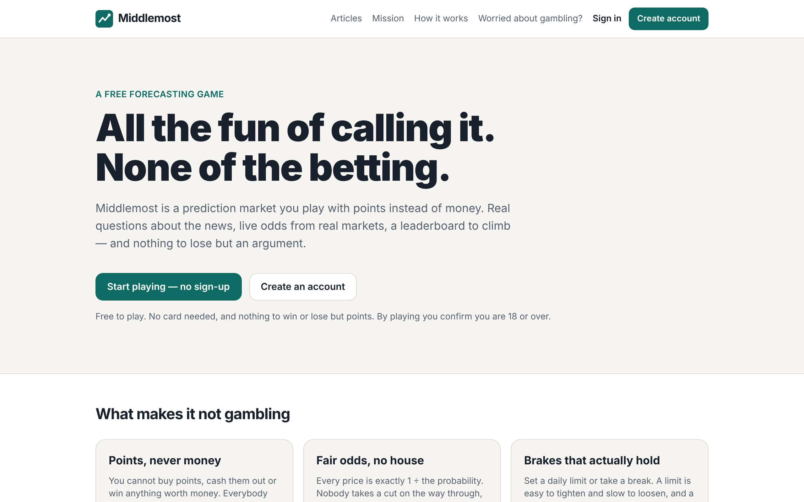
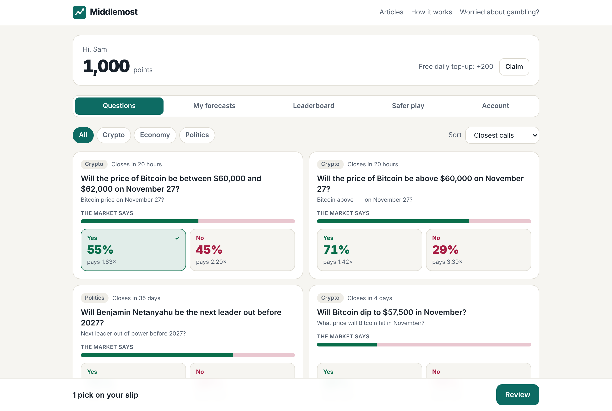
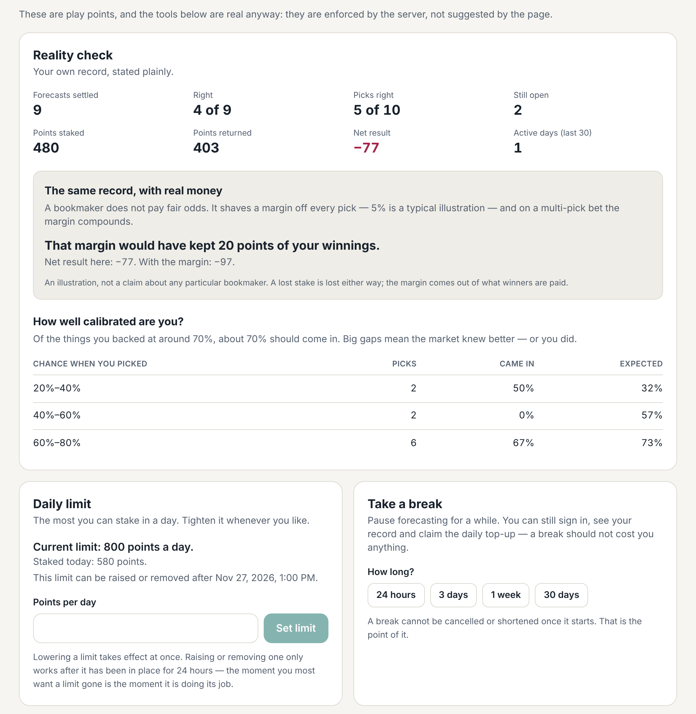
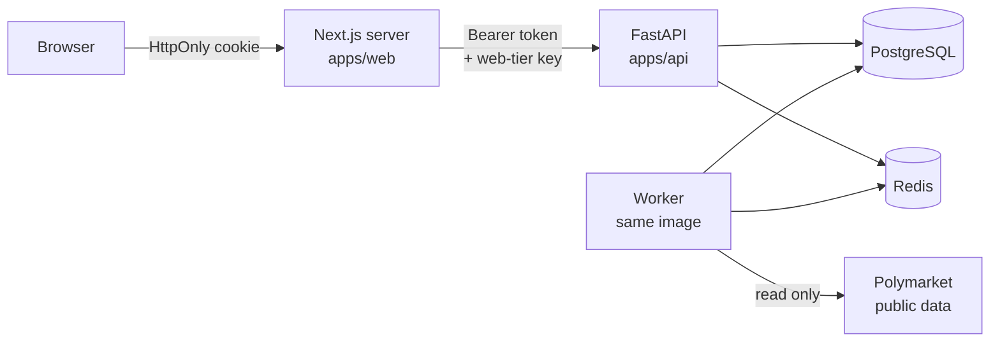

# Middlemost

**Prediction markets without the gambling.** A free forecasting game: real
questions about the news, live odds taken from real markets, and points that
can never be cashed out.



Calling an outcome, putting something behind it and finding out whether you
were right is genuinely fun. Most places that let you do it are built to keep
you there after you have lost money. This is the same game with the money
taken out and those mechanisms left out — an alternative for people who enjoy
the forecasting and do not want the rest. The site states its
[mission](apps/web/lib/content.ts) in full, including what it will not do.

It is also a portfolio project: a small system with the parts a larger one
has, built end to end with AI coding agents under human direction, with the
behaviour pinned by tests.

- [What makes it not gambling](#what-makes-it-not-gambling)
- [What you can do](#what-you-can-do)
- [How it is paid for](#how-it-is-paid-for)
- [How it is built](#how-it-is-built)
- [Run it locally](#run-it-locally)
- [Tests](#tests)
- [Deploying](#deploying)
- [Limits and non-goals](#limits-and-non-goals)

## What makes it not gambling

Gambling needs three things: something of value staked, an outcome you do not
control, and something of value to win. Here there is nothing to win — not as
a policy, but because no table, column or route moves value out — and nothing
has to be staked, because the points are free.

| On a betting site | Here |
| --- | --- |
| You deposit money to play | Playing is free. Everyone starts with 1,000 points and can claim 200 more each day, for good |
| You can win money or prizes | Points buy nothing and redeem for nothing. The leaderboard has no prizes |
| The price includes a margin, and it compounds on multi-pick bets | Odds are exactly `1 ÷ probability`. Nothing is taken out at any length |
| Streaks, boosts and limited-time offers bring you back | The daily top-up is flat, so a missed day costs nothing. Nothing is boosted and nothing is on offer for a limited time |
| Limits are a setting you can undo in a click | A limit lowers at once and takes 24 hours to raise. A break cannot be cut short |
| Your losses are your business | A reality check shows your record, and what it would have cost at a bookmaker |

The codebase began as a conventional betting-style product. These were
**removed, not switched off** — the settings no longer exist, so nothing is one
environment variable away from coming back:

- prizes and anything redeemable
- a house margin on each pick
- a bonus for adding picks to a slip, and paid "insurance" on losing ones
- limited-time boosted odds
- a balance that decays if you stay away
- streak bonuses that punish a missed day
- rewards for recruiting friends
- a live ticker of other people's wins

The original store — points sold for Telegram Stars — was removed with them.
Selling points has since come back in a different shape, optional and hedged
about: see [How it is paid for](#how-it-is-paid-for). What has not come back,
and has no code to come back through, is any way for value to leave.

This is a description of how the game works, not legal advice, and it is not
a treatment for a gambling problem. For some people in recovery, odds and
stakes of any kind are a trigger; the site says so plainly and links to
[real help](apps/web/app/help/page.tsx) from every page.

## What you can do



- **Play at once, as a guest**, or create an account with an email and a
  password. A guest who signs up keeps their points and their record.
- **Forecast real questions** — politics, the economy, crypto — priced from
  Polymarket's public market data. Pick yes or no, stake some points, and
  combine up to five questions on one slip.
- **See the honest number.** Every slip shows the chance it comes in, not
  just what it pays.
- **Follow your record**: open and settled forecasts, and a monthly
  leaderboard for bragging rights.
- **Use the brakes**: a daily limit, a break of a day to a month, a reminder
  after a set time on the site, and account deletion that works immediately.
- **Read**: plain-English guides to how odds, margins and prediction markets
  work, and to stepping back from gambling — each with its sources listed.
- **Write**: anyone with an account can write an article. A person reads it
  before it is published.
- **Run it**: an operator view with player support, an inbox, a review queue
  for articles, an overview of where points went, and diagnostics that name
  which layer is unhealthy.



## How it is paid for

There is no advertising and no money from gambling companies — no sponsorship,
no affiliate links, no selling of data — because each of those would put the
site on the wrong side of the people it is for. That leaves its author and its
users, and two optional ways for users to help. **Both are off until
configured**; out of the box nothing is for sale and the site says so.

- **Donations.** Set `DONATE_URL` on the site to a Stripe Payment Link and the
  [support page](apps/web/app/support/page.tsx) shows a Donate button. It is a
  plain link: no Stripe script runs on the site.
- **Buying points.** Set `STRIPE_SECRET_KEY` on the API and packs of points go
  on sale through Stripe Checkout. Points are credited only by a
  [signature-checked webhook](apps/api/backend/clients/stripe.py), never by
  the browser coming back from the payment page, and once per purchase however
  often the message arrives.

"You have run out — pay to carry on" is the mechanism people come here to get
away from, so [the shop](apps/api/backend/repositories/shop.py) is built with
the brakes in it rather than added afterwards:

| | |
| --- | --- |
| A monthly cap | No account can spend more than the cap ($20 by default) in a calendar month, and an open checkout counts as spent, so the cap cannot be stepped over by starting several. The service refuses to start with the cap set to zero or less |
| A limit of your own | Any amount below the cap, down to zero, which closes the shop for that player. Lowered at once; raised only after it has stood for a day |
| One price per point | A bigger pack is never cheaper per point. There is no setting for a volume discount |
| Not during a break | A break closes the shop as well as the game, and buying points does not raise a daily forecast limit |
| Free first | The free top-up is offered before the shop, every time. The link to the shop does not appear when a balance runs out — it sits in the same place whatever the balance |
| Nothing leaves | Bought points are the same as free ones: no cash value, no withdrawal, no transfer |
| Refunds | A refund or dispute in Stripe takes the points back automatically |

If you run this yourself: selling virtual currency is treated differently from
place to place, and payment processors have their own rules about anything
that resembles gambling. Check both before you set the key. The numbers above
are defaults in [`apps/api/.env.example`](apps/api/.env.example).

## How it is built



```
apps/web/     Next.js 16 (App Router), React 19, Tailwind 4 — the site and its server
apps/api/     FastAPI on asyncpg — accounts, pricing, placement, settlement, workers
db/           SQL migrations, applied in order, and the schema's invariants
scripts/      The migration runner
render.yaml   The API, its database and its cache, as a Render Blueprint
```

Some of it is worth reading:

**The browser holds no credential.** It has an HttpOnly, `SameSite=Lax` cookie
it cannot read. The Next.js server turns that into a bearer token and forwards
an [explicit allowlist](apps/web/app/api/%5B...path%5D/route.ts) of requests;
[`proxy.ts`](apps/web/proxy.ts) refuses any state-changing request that did not
come from the site's own pages. The API's address never reaches a browser.

**Sessions are rows, not just signatures.** The token is a pointer to a
session record, so signing out, changing a password and deleting an account
revoke access immediately instead of waiting for an expiry.

**Sign-in is built to be attacked.** Passwords are hashed with Argon2id off the
event loop, behind a semaphore sized to the container. An unknown email costs
the same time as a wrong password. Attempts are throttled per account and per
visitor in Redis with an atomic script, and the routes that open a session
only answer the web tier, which proves itself with a
[shared key](apps/api/backend/security/webtier.py).

**Every point is a ledger row.** Balances are never written directly: an
append-only ledger drives them through a trigger that refuses an overdraft,
idempotency keys make a retried request safe, and a reconciliation view
([`0001_init.sql`](db/migrations/0001_init.sql)) lists any account whose
balance and ledger disagree — which the tests assert is none.

**The pricing is small enough to audit.**
[`engine/odds.py`](apps/api/backend/engine/odds.py) is `1 ÷ p`, rounded down.
An outcome the market prices outside 1%–99% is refused rather than clamped —
clamping would overpay near-certain outcomes — and two picks from the same
event are refused because their outcomes are tied together.

**The brakes are enforced where the forecast is placed.** Limits and breaks
are checked under a row lock in the same transaction that debits the stake, so
two requests arriving together cannot both get through
([`safer_play.py`](apps/api/backend/repositories/safer_play.py),
[`predictions.py`](apps/api/backend/repositories/predictions.py)).

**Workers survive each other.** Discovery, price sync, resolution and the
leaderboard roll-up run on a schedule in one process. A lease that expires by
itself keeps replicas from doing the same work twice, every run records how it
went, and the diagnostics endpoint says whether the database, the worker, the
source or the cache is at fault.

**Migrations are checksummed.** [`scripts/migrate.py`](scripts/migrate.py)
applies each file once, in a transaction with its own bookkeeping, and refuses
to run if an applied file has been edited since. Every table has row security
enabled, the runner's own included, so a database host that puts a REST API in
front of Postgres exposes nothing.

**The words are in one place.** Everything a visitor reads lives in
[`lib/copy.ts`](apps/web/lib/copy.ts) and
[`lib/content.ts`](apps/web/lib/content.ts), and any sentence that states a
number reads it from the API's live rules. CI fails if text is typed straight
into a component.

**Nothing unreviewed is published.** A site that search engines file under
gambling, with a box that publishes whatever is typed into it, fills with
casino advertising. So a reader's article waits for an operator, a refusal
always carries a reason the author is shown, and the article is rendered from
Markdown with no raw HTML and no images — it cannot carry a script or a
tracking pixel whatever a reviewer misses. Its links are marked as
user-generated and not followed, which removes the reason to write one in
order to place a link ([`articles.py`](apps/api/backend/repositories/articles.py),
[`Prose.tsx`](apps/web/components/Prose.tsx)).

**The guides are reviewed like code.** The site's own articles are Markdown
files in [`content/articles`](apps/web/content/articles), each stating its
sources. A guide with no sources, a description of the wrong length, or a link
to a guide that does not exist fails the build.

**Public pages are built once.** Nothing a stranger or a crawler sees reads
the request, so those pages are static, cached and refreshed in the
background, and they still load when the API does not. Each states its
canonical address, a description and a preview image; there is a sitemap with
real dates and structured data that claims nothing the page does not show
([`seo.ts`](apps/web/lib/seo.ts)).

**No third-party scripts.** No web fonts, no advertising, no trackers. Page
views are counted by the host without cookies, and the
[privacy page](apps/web/lib/content.ts) says exactly what is stored.

## Run it locally

You need Docker, Python 3.11+ with [uv](https://docs.astral.sh/uv/), and
Node 20.9 or newer.

```bash
make db-up                    # Postgres and Redis; creates appdb and appdb_test
make api-install web-install  # the API's virtualenv and the site's node_modules

cp apps/api/.env.example apps/api/.env
cp apps/web/.env.example apps/web/.env.local
```

Set `JWT_SECRET` in `apps/api/.env` — the API will not start without one:

```bash
python -c "import secrets; print(secrets.token_urlsafe(48))"
```

Then:

```bash
make migrate       # apply the schema
make api-workers   # the API on :8000, pulling live questions
make web-dev       # in a second terminal: the site on http://localhost:3000
```

The first questions appear within half a minute of the API starting. To open the
operator pages, create an account, copy its six-character player code from the
Account tab into `ADMIN_PLAYER_CODES` in `apps/api/.env`, and restart the API.

`make help` lists everything else. Each setting is explained in
[`apps/api/.env.example`](apps/api/.env.example) and
[`apps/web/.env.example`](apps/web/.env.example).

## Tests

```bash
make api-test api-lint        # needs the services from `make db-up`
make web-typecheck web-build
make schema-test              # needs PostgreSQL's own binaries (initdb) on PATH
```

`make test` runs all of it.

| What | How |
| --- | --- |
| Schema invariants | Every migration replayed into a throwaway cluster, then [`invariants.sql`](db/tests/invariants.sql): the ledger cannot overdraw, a balance always equals its ledger, a purchase is credited once and refunded no more than it gave |
| API | Close to 700 tests against a real Postgres and Redis: pricing, placement, settlement, sign-in, throttling, limits and breaks, articles and their review, the shop (webhook signatures, the cap under a burst of simultaneous checkouts, refunds), the workers, and the migration runner itself |
| Configuration | The example environment file is [checked against the code](apps/api/tests/test_env_example.py), so it cannot advertise a setting that is gone |
| Site | Typecheck, production build, and a check that no UI text is hard-coded |

CI runs all of it on every push ([`ci.yml`](.github/workflows/ci.yml)).

## Deploying

[`render.yaml`](render.yaml) is a Blueprint that creates the API, a Postgres
database and a cache, wired together, with nothing to paste in; the file's own
comments walk through a first deploy. To start with, the API and the scheduled
jobs run in one process. The same image can be run twice, as an API and a
separate worker, when there is traffic to justify it — every job takes a lease,
so that is safe. The site is a Next.js app deployed from `apps/web`.

| Where | Variable | Value |
| --- | --- | --- |
| API | `DATABASE_URL`, `REDIS_URL` | Filled in by the Blueprint. With a database of your own, use a direct or session-mode connection string, not a transaction pooler |
| API | `JWT_SECRET`, `INTERNAL_API_KEY` | Generated by the Blueprint |
| API | `ADMIN_PLAYER_CODES` | Your own player code, once your account exists |
| Site | `API_BASE_URL` | The API's public URL. A production build without it is a reading-only site: the guides and the mission are there, and every door into the game says it is not open yet |
| Site | `INTERNAL_API_KEY` | The same value the API has |
| Site | `NEXT_PUBLIC_SITE_URL` | The one public address, e.g. `https://example.com` — canonical links and the sitemap are built from it |
| Site | `GOOGLE_SITE_VERIFICATION`, `BING_SITE_VERIFICATION` | Optional: ownership strings from the search consoles |
| Site | `DONATE_URL` | Optional: a Stripe Payment Link. Unset, there is no Donate button |
| API only | `STRIPE_SECRET_KEY`, `STRIPE_WEBHOOK_SECRET`, `SITE_URL` | Optional, and together: they open the shop. The webhook endpoint is `https://<api>/v1/payments/stripe/webhook` |

In production the API refuses to start without a signing secret and a web-tier
key of at least 32 characters each.

The site trusts its hosting platform to report the visitor's address, which
the sign-up throttle depends on. That is correct on a platform that overwrites
`X-Real-IP` and `X-Forwarded-For` itself; behind any other proxy, set
`CLIENT_IP_HEADER` as described in the site's example file.

### Moving the original deployment over

Migration `0016` is additive and drops nothing.

- Accounts created through the old Telegram client stay in the database but
  have no email or password, so they cannot sign in to the site.
- `ADMIN_PLAYER_CODES` replaces `ADMIN_TELEGRAM_IDS`, and `INTERNAL_API_KEY`
  is new and required on the API and the site. Every other old
  variable is ignored and can be deleted.
- The retired tables — Telegram Stars purchases, rewards, boosts and the rest —
  are kept with the rows they already hold. Nothing writes to them, and the
  migration marks everything in them as no longer on sale. Points bought
  through the website are recorded separately, in `point_purchases`.
- Earlier migrations still contain the old product's text. They are
  checksummed, so they are superseded rather than edited.

## Limits and non-goals

- **Nothing sends email.** Addresses are not verified and there is no password
  reset: a forgotten password cannot be recovered.
- **A guest account lives in one browser.** Clear the cookie and it is gone.
  The site tells guests so, and offers to make the account permanent.
- **Age is self-declared.** The site is for adults and says so; it does not
  check. Buying points asks for the declaration again.
- **The shop does not know where a buyer is.** It applies the same cap to
  everyone and does not block by country or state.
- **Prices are borrowed.** Questions and odds come from Polymarket's public
  data. This project is not affiliated with Polymarket and places no trades.
  When the source is unreachable, questions show as updating and cannot be
  picked.
- **Rate limits fail open.** If Redis is down, sign-in keeps working without a
  throttle rather than locking everybody out.
- **It is a game, not a service for problem gambling.** The help page links to
  people who are.

## If gambling is costing you more than you want it to

Free, confidential help exists, and none of it is this website:
[Gambling Therapy](https://www.gamblingtherapy.org/) (worldwide, many
languages), [GamCare](https://www.gamcare.org.uk/) (UK),
the [National Problem Gambling Helpline](https://www.ncpgambling.org/help-treatment/)
(US) and [Gamblers Anonymous](https://www.gamblersanonymous.org/).
